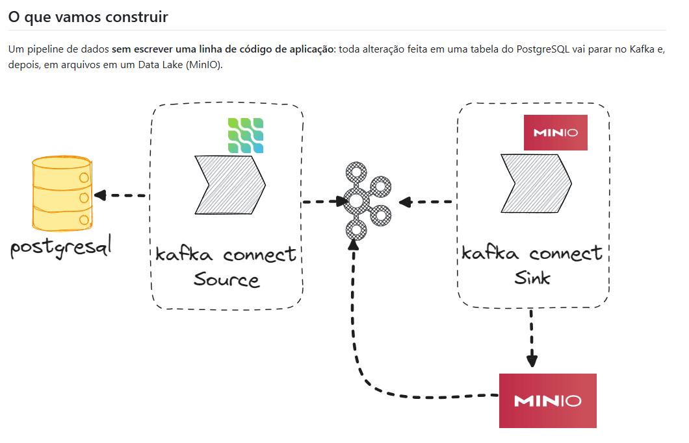

# Lab EDA: Kafka Connect

Pipeline de dados orientado a eventos (EDA), **sem código de aplicação**: toda alteração em uma tabela do PostgreSQL é capturada por CDC, publicada no Kafka e gravada como arquivo no Data Lake (MinIO).

> Projeto de estudo da Pós-Graduação em Engenharia de Dados, baseado no lab **21.Ingestao-Dados-Kafka-Connect** do material do curso. As configurações seguem o material e incluem práticas de produção onde fazem sentido.



```
PostgreSQL ──(Source: Debezium)──► Kafka ──(Sink: S3)──► MinIO (bucket bronze)
                                     ▲                          │
                                     └──── evento "arquivo criado" ┘
```

---

## Status

| Parte | Componente | Status |
|---|---|---|
| — | PostgreSQL (WAL `logical`) + pgAdmin | ✅ Concluído |
| — | MinIO + criação dos buckets | ✅ Concluído |
| 1 | Zookeeper | ✅ Concluído |
| 2 | Kafka broker | ✅ Concluído |
| 3 | Interface web do Kafka (AKHQ) | ✅ Concluído |
| 4 | Kafka Connect | ⏳ Pendente |
| 5 | Conector Source (PostgreSQL → Kafka) | ⏳ Pendente |
| 6 | Conector Sink (Kafka → MinIO) | ⏳ Pendente |
| 7 | Notificação MinIO → Kafka | ⏳ Pendente |

---

## Stack

| Serviço | Imagem | Função |
|---|---|---|
| `postgres` | `postgres:16` | Banco de origem, com WAL em `logical` para o CDC |
| `pg-admin` | `dpage/pgadmin4:9.0` | Interface web do PostgreSQL |
| `minio` | `quay.io/minio/minio:RELEASE.2025-02-28T09-55-16Z` | Data Lake compatível com S3 |
| `mc` | (mesma imagem do `minio`) | Cria os buckets `bronze`, `silver` e `gold`, depois termina |
| `zookeeper` | `confluentinc/cp-zookeeper:7.6.1` | Coordenação do cluster Kafka |
| `kafka-broker` | `confluentinc/cp-kafka:7.6.1` | Broker Kafka |
| `akhq` | `tchiotludo/akhq:0.20.0` | Interface web do Kafka |

---

## Como executar

### Pré-requisitos
- Docker Desktop (com WSL 2 no Windows)
- Docker Compose v2

### 1. Configurar as credenciais

```sh
cp .env.example .env
```

Preencha o `.env`. Ele guarda **apenas usuários e senhas**; as versões das imagens ficam fixas no `docker-compose.yml`.

| Variável | Uso |
|---|---|
| `PG_USER` / `PG_PASSWORD` | Superusuário do PostgreSQL |
| `PG_DB` | Banco criado na primeira inicialização |
| `PGADMIN_EMAIL` / `PGADMIN_PASSWORD` | Login do pgAdmin (o email precisa ter formato válido) |
| `MINIO_USER` / `MINIO_PASSWORD` | Administrador do MinIO (senha com no mínimo 8 caracteres) |
| `KAFKA_UI_USER` / `KAFKA_UI_PASSWORD` | Login do Kafka UI (alternativa ao AKHQ, ver `docker-compose.example.yml`) |

> O `.env` não deve ir para o Git. O `.env.example` contém só as chaves, com valores de exemplo.

### 2. Subir o ambiente

```sh
docker compose up -d
docker compose ps -a
```

Os serviços sobem na ordem certa graças ao `depends_on` com `condition: service_healthy`: `zookeeper` → `kafka-broker` → `akhq`. O processo leva de 1 a 2 minutos.

### 3. Parar o ambiente

```sh
docker compose down      # remove os containers e MANTÉM os dados (volumes)
docker compose down -v   # remove os containers e APAGA os dados
```

---

## Interfaces e portas

| Serviço | Endereço na sua máquina | Endereço dentro da rede `dados` |
|---|---|---|
| pgAdmin | http://localhost:5433 | — |
| MinIO Console | http://localhost:9001 | — |
| MinIO API (S3) | `localhost:9000` | `minio:9000` |
| AKHQ | http://localhost:8080/ui | — |
| PostgreSQL | `localhost:5432` | `postgres:5432` |
| Kafka | `localhost:9092` | `kafka-broker:29092` |
| Zookeeper | `localhost:2181` (só para estudo) | `zookeeper:2181` |

> **Regra dos endereços do Kafka:** clientes **dentro** do Docker (Connect, AKHQ, MinIO) usam `kafka-broker:29092`. Clientes **fora** (scripts na sua máquina) usam `localhost:9092`.

O pgAdmin já sobe com o servidor PostgreSQL cadastrado (`pgadmin/servers.json`); a senha é pedida no primeiro acesso.

---

## Testes de cada componente

**PostgreSQL: WAL pronto para o CDC**
```sh
docker compose exec postgres psql -U <PG_USER> -d <PG_DB> -c "SHOW wal_level;"
# esperado: logical
```

**Zookeeper**
```sh
docker compose exec zookeeper bash -c "echo ruok | nc localhost 2181"
# esperado: imok
docker compose exec zookeeper zookeeper-shell localhost:2181 ls /brokers/ids
# esperado: [1]  (o broker se registrou)
```

**Kafka: criar um tópico, produzir e consumir**
```sh
docker compose exec kafka-broker kafka-topics --bootstrap-server localhost:9092 --create --topic teste --partitions 3 --replication-factor 1
docker compose exec kafka-broker kafka-console-producer --bootstrap-server localhost:9092 --topic teste
docker compose exec kafka-broker kafka-console-consumer --bootstrap-server localhost:9092 --topic teste --from-beginning
```

**Investigar um container que não sobe**
```sh
docker compose ps -a              # ele parou? (Exited)
docker compose logs <serviço>     # por que parou?
```

---

## Estrutura do projeto

```
.
├── docker-compose.yml           # Ambiente do lab (1 broker)
├── docker-compose.example.yml   # Estudo: cluster com 3 brokers + AKHQ e Kafka UI
├── .env.example                 # Modelo das credenciais
├── DockerFile                   # Reservado: imagem do Kafka Connect (Parte 4)
├── pgadmin/
│   └── servers.json             # Servidor PostgreSQL pré-cadastrado no pgAdmin
└── docs/
    └── arquitetura.png
```

---

## Diferenças em relação ao material do curso

| Material | Este projeto | Motivo / impacto |
|---|---|---|
| `debezium/example-postgres` com o schema `inventory` | `postgres:16` com `wal_level=logical` no `command` | Configuração do WAL explícita. As tabelas são criadas manualmente e os tópicos ficam `postgres.public.<tabela>`. |
| Usuário e banco `postgres` | Variáveis do `.env` | Ajustar `database.user`, `database.password` e `database.dbname` no conector |
| Plugin de decodificação já instalado na imagem | PostgreSQL "puro" | O conector Debezium precisa de `"plugin.name": "pgoutput"` |
| Credenciais fixas no compose | Credenciais no `.env` | Segredos fora do código |
| Versões no `.env` | Versões fixas no compose | O `.env` guarda só credenciais |
| `ZOOKEEPER_4LW_COMMANDS_WHITELIST: "*"` | `KAFKA_OPTS: -Dzookeeper.4lw.commands.whitelist=ruok` | A imagem `cp-zookeeper:7.6.1` **ignora** a variável do material. A propriedade Java funciona e libera só o necessário. |
| `container_name` fixo | Nomes gerados pelo Compose | Usar `docker compose exec <serviço>` em vez de `docker exec <container>` |

---

## Práticas de produção aplicadas

- **Versões fixas** das imagens (nunca `latest`)
- **Healthchecks** no PostgreSQL, Zookeeper e Kafka, e `depends_on` com `service_healthy`, para que nenhum serviço suba antes da dependência estar pronta
- **`restart: unless-stopped`** no Zookeeper, Kafka e AKHQ
- **Volumes nomeados** para os dados (Kafka, Zookeeper, PostgreSQL, MinIO, pgAdmin)
- **Volumes separados** para os snapshots e o log de transações do Zookeeper
- **Whitelist mínima** de comandos 4LW no Zookeeper (só `ruok`)
- **`ulimits`** de arquivos abertos no Zookeeper e Kafka (efeito real em servidores Linux)
- **Rede dedicada** (`dados`) e porta interna do Kafka (`29092`) não exposta

---

## Pontos a melhorar

- **Segurança do Kafka:** trocar `PLAINTEXT` por `SASL_SSL` (criptografia + autenticação)
- **Criação de tópicos:** `KAFKA_AUTO_CREATE_TOPICS_ENABLE: "false"` e tópicos criados de forma explícita
- **Retenção:** definir por pipeline no conector (`topic.creation.default.retention.ms`)
- **Zookeeper:** não expor a porta `2181`, desligar o AdminServer (`ZOOKEEPER_ADMIN_ENABLE_SERVER: "false"`) e usar 3 nós (quórum)
- **Alta disponibilidade:** 3 brokers com replicação 3 (ver `docker-compose.example.yml`)
- **Usuário dedicado para o Debezium**, com `REPLICATION` e `SELECT`, em vez do superusuário
- **`restart: unless-stopped`** também no PostgreSQL, pgAdmin e MinIO
- **Modo KRaft**, que elimina o Zookeeper (não adotado neste lab, para seguir o material)
- **Interface AKHQ:** a versão 0.20.0 é antiga. Existem versões mais novas e a alternativa Kafka UI (kafbat).

---

## Avisos

- **Imagens do MinIO:** o download das imagens do MinIO (`quay.io/minio/*` e `minio/*`) está sendo negado pelos registries. O ambiente funciona porque a imagem do servidor já está baixada localmente, e o serviço `mc` reaproveita essa imagem, que traz o cliente `mc` embutido. **Não remova essa imagem** (`docker image rm`, `docker system prune -a`). Para recriar o ambiente em outra máquina, será preciso uma alternativa compatível com S3.
- **Configurações de primeira inicialização** (usuário e banco do PostgreSQL, servidor do pgAdmin) só são aplicadas com o volume vazio. Para reaplicá-las, use `docker compose down -v` (apaga os dados).

---

## Referências

- Material do curso: `Engenharia-Dados/21.Ingestao-Dados-Kafka` e `21.Ingestao-Dados-Kafka-Connect`
- [Apache ZooKeeper: Administrator's Guide](https://zookeeper.apache.org/doc/current/zookeeperAdmin.html)
- [Apache Kafka: Documentation](https://kafka.apache.org/documentation/)
- [Confluent: Docker Configuration Reference](https://docs.confluent.io/platform/current/installation/docker/config-reference.html)
- [Docker Compose: file reference](https://docs.docker.com/reference/compose-file/services/)
- [Debezium: PostgreSQL connector](https://debezium.io/documentation/reference/stable/connectors/postgresql.html)
